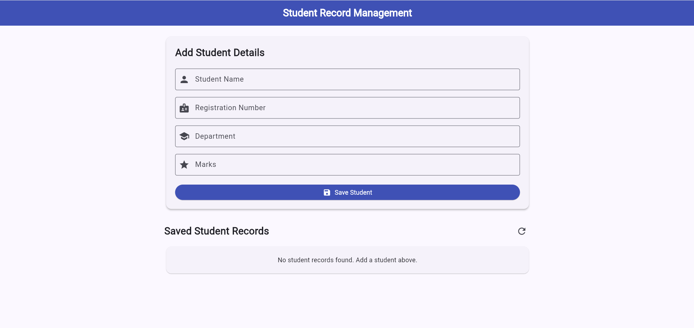
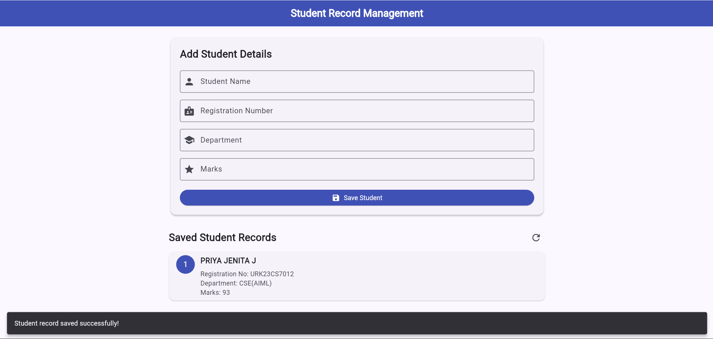
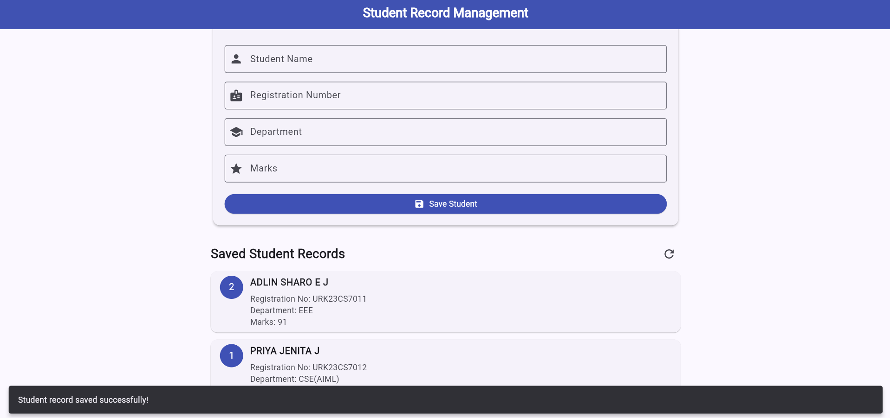

# Experiment 6 – Data Persistence Using SQLite

## Aim

To design and develop a Flutter application that stores and retrieves student records using an SQLite database by implementing Create and Read operations.

## Description

This experiment demonstrates the implementation of Data Persistence using SQLite in a Flutter application.

The application allows users to enter student details and store them in an SQLite database. The saved student records are retrieved from the database and displayed on the application screen.

The application consists of the following features:

- **Student Details Form** – Allows the user to enter the student's name, registration number, department, and marks.
- **Save Student** – Stores the entered student details in the SQLite database.
- **Saved Student Records** – Retrieves and displays all saved student records.
- **Form Validation** – Validates the required input fields and ensures that marks are between 0 and 100.
- **Refresh Records** – Reloads the student records from the database.

The application uses:

- **Flutter** to develop the user interface
- **Dart** as the programming language
- **SQLite Database** to store student records
- **sqflite Package** to perform database operations
- **sqflite_common_ffi_web Package** to provide SQLite support for Flutter Web
- **path Package** to construct the database path on supported native platforms
- **DatabaseHelper Class** to manage database initialization and operations
- **CREATE TABLE** to create the students table
- **insert()** to insert new student records into the database
- **query()** to retrieve saved student records
- **TextFormField** to accept student details
- **TextEditingController** to read and manage user input
- **Form Validation** to validate the entered details
- **ListView and ListTile** to display the saved student records
- **ScaffoldMessenger** to display success and error messages

The application stores the following student information:

- **Student ID**
- **Student Name**
- **Registration Number**
- **Department**
- **Marks**

The application implements the following database operations:

- **Create Operation** – Inserts a new student record into the SQLite database.
- **Read Operation** – Retrieves the stored student records and displays them on the screen.

## Technologies Used

- Flutter
- Dart
- SQLite
- sqflite
- sqflite_common_ffi_web
- path
- DatabaseHelper
- CREATE TABLE
- insert()
- query()
- TextFormField
- TextEditingController
- Form Validation
- ListView
- ListTile
- ScaffoldMessenger

## Output Screenshots

### Student Details Form

### Entered Student Details

### Successful Record Insertion

## Result

A Student Record Management application was successfully designed and implemented using Flutter, Dart, and SQLite. The application stores student details using the Create operation and retrieves and displays the saved records using the Read operation. The experiment demonstrates the implementation of database integration and data persistence in a Flutter application.
